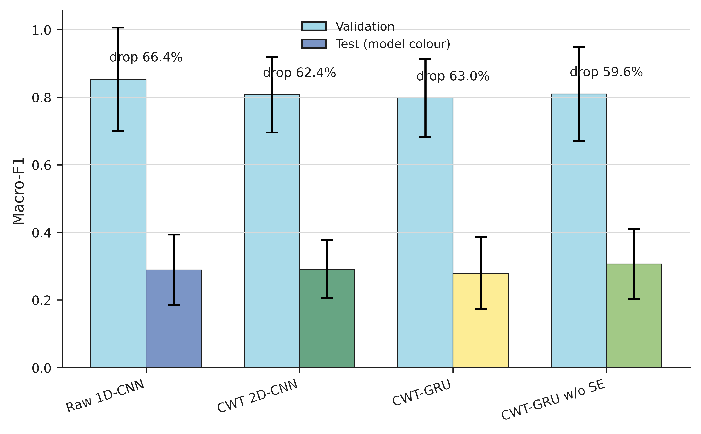

# Leakage-Safe Bearing Fault Diagnosis Benchmark

Official implementation and reproducibility package for:

**Leakage-Safe Cross-Domain Benchmarking for Bearing Fault Diagnosis: Time-Frequency Fusion, Calibration, and Self-Training**

This repository evaluates whether commonly used bearing-fault-diagnosis
techniques remain effective when both **physical bearing identity** and
**operating condition** are unseen during testing.

[](https://www.python.org/)
[](https://pytorch.org/)
[](LICENSE)
[](docs/reports/CLEAN_REPRODUCTION_REPORT.md)
[](docs/PROTOCOL.md)
[](docs/paper/Leakage_Safe_Bearing_Benchmark_SCI_final.docx)

## Overview

This is a benchmark, evaluation-methodology, and negative-results study, not a
new high-scoring architecture.

The benchmark enforces:

- physical-bearing-disjoint training and testing;
- operating-condition-disjoint training and testing;
- non-overlapping 8192-sample signal windows;
- validation-only early stopping and calibration;
- matched fold-seed comparisons;
- fold-first hierarchical statistical inference.

The central question is whether an advantage survives simultaneous removal of
familiar bearings and operating conditions.

## Key Findings

- Validation Macro-F1 remained approximately **0.797-0.853**, while held-out test Macro-F1 decreased to **0.280-0.307**.
- No stable advantage was established for the evaluated magnitude-CWT, recurrent-fusion, or SE variants.
- Temperature scaling improved probability calibration for selected CWT models but did not change argmax classification.
- Fixed-threshold self-training did not establish a stable diagnostic improvement.
- High pseudo-label accuracy did not necessarily translate into better cross-domain end-task performance.

## Generalization Gap

<p align="center">
  
</p>

Strong development-domain performance does not translate into equivalent
performance on simultaneously unseen bearings and operating conditions.
The held-out domain also differs in damage origin for some fault bearings, so
bearing identity, condition, and damage-origin effects are coupled and cannot be
causally separated.

## Main Results

Values are mean +/- sample standard deviation over four folds and five seeds.
The formal registry contains 320 canonical evaluations and 40 external
same-protocol adaptation runs.

| Method | Test Macro-F1 | Accuracy |
| --- | ---: | ---: |
| Raw 1D-CNN | 0.289 +/- 0.104 | 0.392 +/- 0.094 |
| GRU only | 0.221 +/- 0.030 | 0.242 +/- 0.025 |
| CWT 2D-CNN | 0.291 +/- 0.086 | 0.399 +/- 0.081 |
| CWT-GRU without SE | 0.307 +/- 0.103 | 0.408 +/- 0.097 |
| CWT-GRU | 0.280 +/- 0.107 | 0.383 +/- 0.092 |
| CWT-GRU + temperature scaling | 0.280 +/- 0.107 | 0.383 +/- 0.092 |
| CWT-GRU + temperature scaling + self-training | 0.290 +/- 0.116 | 0.387 +/- 0.099 |

These results support configuration-specific empirical conclusions. They do not
show that CWT, GRU, SE, or self-training is universally ineffective.

## Experiment Status

> **All reported experiments completed as designed; not all evaluated methods produced positive or statistically stable gains.**

| Experiment group | Status | Main outcome |
| --- | --- | --- |
| Main benchmark | Completed | No stable advantage established for evaluated CWT/recurrent/SE variants |
| Calibration | Completed | Probability metrics changed without changing argmax classification |
| Self-training | Completed | No stable diagnostic improvement established |
| Threshold sensitivity | Completed | Higher pseudo-label accuracy did not guarantee higher Macro-F1 |
| Label efficiency | Completed | Performance depended strongly on the verified-label budget |
| External baselines | Completed | Same-protocol adaptations did not outperform Raw 1D-CNN |
| CWT sensitivity | Completed | No universal CWT advantage established |
| Training opportunity | Completed | Longer training did not alter the main conclusion |
| Embedding diagnostics | Completed | Post-hoc analysis only |

## Leakage-Safe Protocol

The four test domains use operating conditions `C0-C3`. In each fold, one
condition is held out for test, a second condition is validation, and the other
two conditions are used for training. The development bearings exclude
`K005`, `KA15`, `KI14`, and `KB27` from all fitting data.

```text
4 operating-condition folds
5 seeds: 42, 123, 2024, 2025, 3407
20 matched evaluations per method condition
```

Test data never enters training, calibration fitting, pseudo-label generation,
threshold selection, hyperparameter selection, or model selection. Primary
paired inference resamples the four folds first and five seeds within each
selected fold. The minimum attainable non-zero two-sided exact sign-flip
p-value is `0.125`.

See [docs/PROTOCOL.md](docs/PROTOCOL.md) for the full fold table and leakage
boundaries.

## Repository Structure

```text
.
├── .github/       # CI verification
├── configs/       # Frozen experiment configurations
├── data/          # Data instructions and archive manifests; no raw signals
├── docs/          # Detailed documentation and archived reports
├── figures/       # Publication PNG figures and hash manifest
├── results/       # Canonical, external, sensitivity, and post-hoc evidence
├── scripts/       # Stable entry points and audits
├── splits/        # Frozen fold-manifest index
├── src/           # Models, training, evaluation, statistics, visualization
└── tests/         # Split, model, metric, result, and release checks
```

The final editable manuscript is
`docs/paper/Leakage_Safe_Bearing_Benchmark_SCI_final.docx`.
No PDF files are tracked in the repository.

## Quick Verification

Install the package in an environment with a compatible PyTorch build:

```bash
python -m pip install -e ".[dev]"
python scripts/smoke_test.py
```

The smoke test loads the canonical config and split manifests, initializes all
seven models, executes one forward pass per model, runs a metric calculation,
and imports the statistics and visualization style modules.

## Full Reproduction

The core from-scratch workflow is:

```bash
python scripts/prepare_data.py
python scripts/run_main_benchmark.py --experiment all
python scripts/run_external_baselines.py
python scripts/generate_statistics.py
python scripts/generate_figures.py --include-domain-shift
python -m spindle_cnn.paper.build_docx \
  --results-dir results \
  --figures-dir figures/publication \
  --output docs/paper/Leakage_Safe_Bearing_Benchmark_SCI_final.docx
```

The complete command reference, expected outputs, sensitivity runs, and
environment details are in [docs/REPRODUCIBILITY.md](docs/REPRODUCIBILITY.md).

## Result Reproduction

The committed result registry allows the manuscript summary statistics and
figures to be regenerated without retraining the models:

```bash
python scripts/generate_statistics.py
python scripts/generate_figures.py
python scripts/build_paper_metrics.py
python -m spindle_cnn.paper.build_docx \
  --results-dir results \
  --figures-dir figures/publication \
  --output docs/paper/Leakage_Safe_Bearing_Benchmark_SCI_final.docx
```

## Full Experimental Reproduction

Starting from the official raw dataset requires substantially more compute than
result regeneration because it reruns the training matrix:

```bash
python scripts/prepare_data.py
python scripts/run_main_benchmark.py --experiment all
python scripts/run_external_baselines.py
```

The reported experiments used an NVIDIA GeForce RTX 5080. Equivalent
CUDA-capable hardware may be used, although runtime and floating-point behavior
may differ. Different hardware does not guarantee bitwise-identical training.

## Data Availability

The original Paderborn data are not redistributed. Users should obtain the
dataset from the official source and follow
[docs/DATASET.md](docs/DATASET.md).

Raw signals, generated caches, model checkpoints, and temporary logs are
excluded from Git. Official archive names, sizes, and SHA-256 values are in
[`data/manifests/paderborn_archives_sha256.csv`](data/manifests/paderborn_archives_sha256.csv).

## Reproducibility

The repository includes fixed split manifests, canonical configurations,
explicit fold/seed definitions, a per-run result registry, fold-aware
statistical scripts, publication figure generators, same-protocol external
adaptations, and automated audits.

Key evidence:

- [Consistency report](docs/reports/CONSISTENCY_REPORT.md)
- [Reference-link report](docs/reports/REFERENCE_LINK_REPORT.md)
- [README link check](docs/reports/README_LINK_CHECK.md)
- [Clean reproduction report](docs/reports/CLEAN_REPRODUCTION_REPORT.md)
- [Canonical result manifest](results/canonical/manifest.json)
- [Split manifest index](splits/manifest.json)
- [Figure hash manifest](figures/publication/figure_hashes.json)
- [Final release report](FINAL_RELEASE_REPORT.md)

## Scope and Limitations

The benchmark is evaluated only on the Paderborn dataset under one
simultaneous physical-bearing and operating-condition holdout protocol.

Bearing identity, operating condition, and damage-origin effects are coupled
and cannot be causally separated in the current primary design. Findings are
configuration-specific and do not support universal claims about CWT, GRU, SE,
or self-training.

The project has used test outcomes for post-primary descriptive analysis. Its
leakage claim concerns the frozen training, calibration, pseudo-label,
hyperparameter, and model-selection protocol, not complete cognitive isolation.

DRSN and TFN are same-protocol adaptations, not reproductions of their original
reported settings.

## Citation and License

Citation metadata for Huadong Lin is in [CITATION.cff](CITATION.cff). Source and
derived documentation use the [MIT License](LICENSE); original datasets remain
subject to their provider's terms.
